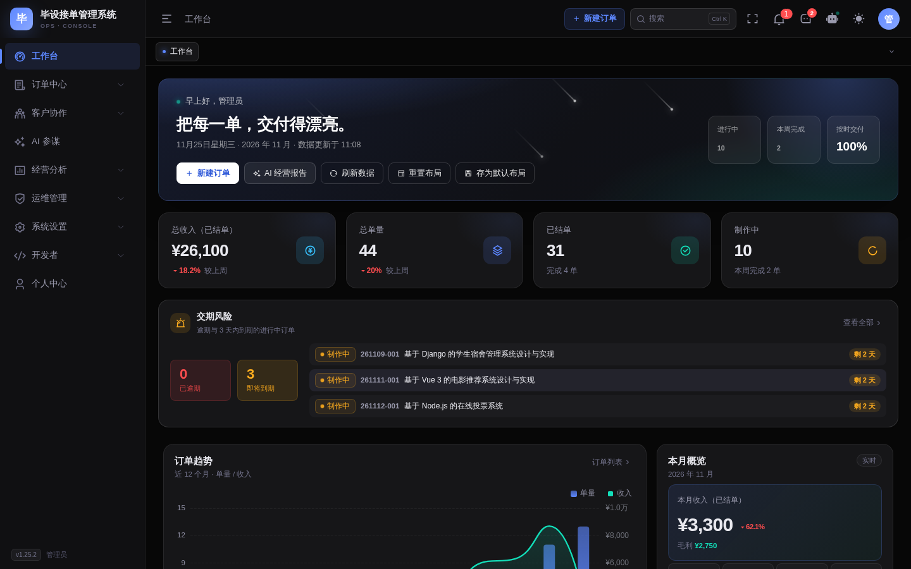

# 毕设接单管理系统

**面向论文 / 程序设计接单团队的一站式订单管理后台**

[](LICENSE) [](CHANGELOG.md)   

[功能特性](#功能特性) · [快速开始](#快速开始) · [角色与权限](#角色与权限) · [文档](#更多文档) · [许可证](#许可证)

## 简介

接单做毕业设计（论文、程序、论文 + 程序），杂事很多：谁下的单、什么品质、交期到哪天、需求书怎么写、程序包和演示视频放哪、代理该结算多少、哪几单快逾期了。用表格和聊天记录来管，迟早会乱。

**毕设接单管理系统**把这些流程收进一个后台：

- **订单一条线**：代理建单、写手制作、管理员统筹，状态、交期和交付物都挂在订单上
- **需求书**：AI 生成、在线编辑、一键导出 Word
- **客户交付**：客户凭链接免登录验收、下载交付物
- **价格隔离**：成交价与写手价分开，不同角色各看各的

部署很简单：**一个 FastAPI 进程同时提供 API、页面和文件下载**，配上 MySQL 即可运行。



## 功能特性

### 订单与交付

| | |
|---|---|
| 📋 **订单全生命周期** | 待开始 → 制作中 → 已完成 → 已结单 / 售后中 / 已取消，按角色与状态机约束流转；回收站软删除，可恢复 |
| 🗂 **项目类型** | 纯程序设计 / 纯论文 / 论文 + 设计；品质分为白、绿、蓝、紫、橙、红六档，倍率可调 |
| 📁 **交付物管理** | 程序包、演示视频、文档分目录存放；大文件分片断点续传；演示视频与程序包「一单一份」，重新上传自动替换并留痕 |
| 📄 **论文进度留档** | 任务书 → 开题报告 → 初稿 → 终稿逐版留档，只追加不覆盖 |
| 🔗 **客户交付链接** | 一键生成免登录交付页，客户在线验收、下载交付物；报价单同样可分享 |
| 📅 **订单日历** | 按交期查看整月排期，支持拖拽改期与导出 ICS 到系统日历 |
| 🏭 **生产看板** | 按状态分栏查看全部进行中订单，交期风险一目了然 |
| 🧾 **Excel 导入导出** | 批量建单、按当前筛选条件导出 |
| 🔍 **全局搜索与命令面板** | `Ctrl + K` 搜单号、题目、页面，键盘直达 |

### 需求书

- **AI 智能生成**：对接 DeepSeek，按题目与技术栈生成九章结构化需求书；未配置 Key 或调用失败时自动回退到模板生成。
- **在线结构化编辑**：项目目标、建设范围、角色定义、核心业务场景、功能需求、业务规则、数据范围、技术架构、数据库设计，逐节编辑，可上传文档一键采用。
- **一键导出 Word**：宋体小四正文、黑体蓝标题、三列表格的规范排版。
- **版本历史与修改对比**：每次保存前自动存档，可回滚；不同版本之间可对比差异。

### 角色与价格

- **三种角色**：管理员、写手、代理，价格按角色隔离（见[角色与权限](#角色与权限)）。
- **双价格体系**：成交价（客户 / 代理口径）与写手价（内部成本）分开存储、分开展示，支持按单浮动调价与多级代理抽成。
- **对账单与毛利分析**：按月核对各代理的结单金额与收付抽成，毛利趋势一图看清。

### 数据与 AI

- **工作台**：收入、单量、交期风险、订单趋势、品质分布等卡片可拖拽排版，布局可保存为默认。
- **经营大屏 / 代理业绩榜**：凭链接对外展示，免登录访问。
- **AI 参谋**：经营风险雷达、需求书体检、客户回访话术、验收清单、订单 AI 摘要与 AI 经营报告；内置每日配额。
- **站内协作**：公告、通知、代理与平台之间的私信、建议反馈、客户库（轻 CRM）。

### 开放 API 与安全

- **代理开放 API**（`/api/v1`）：`X-API-Key` 鉴权，代理可用自己的系统建单、回传状态、拉取需求书与附件，接口说明见应用内「开发者 → API 对接」页。
- **安全**：JWT（HttpOnly Cookie）+ 主动吊销、可选 TOTP 两步验证、敏感操作密码二次确认、上传类型与大小白名单、全参数化 SQL、登录 / 上传 / AI 等接口限流、仅可信代理解析转发头。
- **运维**：加密备份与恢复、系统健康页、操作日志、Webhook 通知（企业微信 / 钉钉）、可选 Redis（多 worker 时共享限流与 WebSocket 广播）。

## 角色与权限

| 角色 | 定位 | 主要能力 | 可见价格 |
|---|---|---|---|
| **管理员** `admin` | 平台方 | 全部功能：用户与品质管理、系统设置、日志、对账、毛利、备份、全部订单 | 成交价 + 写手价 |
| **写手** `staff` | 制作侧 | 查看与制作订单、上传交付物、推进状态、生成与编辑需求书、写手绩效、AI 参谋；**不能建单** | 仅写手价 |
| **代理** `agent` | 销售 / 同行 | 建单、只看自己名下的订单、客户管理与跟进、对账单、订单日历、API Key 对接 | 仅成交价 |

**价格体系**：价格 = 基础价 × 品质倍率，下单时快照到订单上。品质倍率默认 白 ×1、绿 ×2、蓝 ×3、紫 ×4、橙 ×5、红 ×6；成交基础价与写手基础价默认分别为 300 与 50，均可在「系统设置 → 价格与品质」中调整。

> 成交价在界面上也称「真实价」，对应字段 `owner_price`；写手价对应 `agent_price`（旧称「代理价」）。

## 技术栈

| 层 | 选型 |
|---|---|
| 前端 | Vue 3 · Element Plus 2 · Pinia · Vue Router · ECharts 5 · GridStack · Vite 6 |
| 后端 | Python 3.12 · FastAPI · SQLAlchemy 2 · PyMySQL |
| 数据库 | MySQL 8.0（必需）· Redis（可选，仅多 worker 部署需要） |
| AI | DeepSeek 开放平台（可选） |
| 部署 | 前端构建产物由 FastAPI 单进程托管，单端口即可对外服务 |

## 目录结构

```
bs-order-system/
├── .env.example          # 配置模板（复制为 .env 后修改）
├── server/               # 后端
│   ├── app/
│   │   ├── main.py       #   FastAPI 入口：路由、安全头、前端静态托管
│   │   ├── init_db.py    #   建库建表与初始数据
│   │   ├── models.py     #   数据模型
│   │   ├── routers/      #   各业务模块接口
│   │   └── services/     #   定价、单号、需求书、备份、交付、实时推送等
│   ├── scripts/          #   备份恢复、演示数据、重置管理员密码等脚本
│   ├── sql/              #   历史版本的数据库迁移脚本（兜底用）
│   └── tests/            #   pytest 回归测试
├── web/                  # 前端（Vue 3 + Element Plus）
│   ├── src/
│   └── dist/             #   npm run build 的产物，不入库
├── docs/                 # 部署、接口、AI 参谋等文档与截图
├── CHANGELOG.md
├── LICENSE
└── NOTICE
```

## 快速开始

### 环境要求

- Python 3.12
- Node.js 20.19 及以上（推荐 22 LTS）
- MySQL 8.0

### 1. 获取代码并配置

```bash
git clone https://github.com/XYuumi/bs-order-system.git
cd bs-order-system
cp .env.example .env
```

编辑 `.env`，至少修改以下几项：

| 配置项 | 说明 |
|---|---|
| `DB_USER` / `DB_PASSWORD` / `DB_NAME` | MySQL 账号与库名（库名对应的数据库需已创建，字符集 `utf8mb4`） |
| `JWT_SECRET` | **必须修改**，32 位以上随机串：`python -c "import secrets; print(secrets.token_urlsafe(48))"` |
| `BACKUP_ENCRYPTION_KEY` | 建议独立生成：`python -c "from cryptography.fernet import Fernet; print(Fernet.generate_key().decode())"` |
| `COOKIE_SECURE` | 通过 HTTPS 访问时为 `true`；本地用 HTTP 调试时改为 `false` |

完整配置项说明见[部署说明](docs/部署说明.md)。

### 2. 启动后端

```bash
cd server
python3 -m venv .venv
source .venv/bin/activate          # Windows: .venv\Scripts\activate
pip install -r requirements.txt

python -m app.init_db              # 建表并写入初始数据；首次运行会打印初始管理员密码
uvicorn app.main:app --host 0.0.0.0 --port 8000
```

### 3. 构建前端

```bash
cd web
npm ci
npm run build                      # 产物输出到 web/dist
```

打开 <http://127.0.0.1:8000>，使用 `admin` 与上一步打印的密码登录。

> 也可以不在本机装 Node：在任意机器上执行 `npm ci && npm run build`，把生成的 `web/dist` 上传到服务器同样位置即可。

### 开发模式

前后端分开启动，前端由 Vite 开发服务器提供并代理接口：

```bash
# .env 中追加（开发服务器的跨域写请求需要放行）：
#   ALLOWED_ORIGINS=http://localhost:5173,http://127.0.0.1:5173

cd server && uvicorn app.main:app --reload --port 8000     # 终端 1
cd web && npm run dev                                      # 终端 2，访问 http://localhost:5173
```

后端端口不是 8000 时，在 `web/.env.local` 中设置 `VITE_API_ORIGIN=http://127.0.0.1:<端口>`。

### 演示数据

```bash
cd server
python scripts/demo_data.py create     # 生成 2 个代理、1 个写手与 30 笔跨 8 个月的订单，并打印演示账号密码
python scripts/demo_data.py clean      # 清理演示数据
```

## 部署

- [宝塔面板部署](docs/宝塔部署.md)：从上传代码到配置进程、Nginx 反代、计划任务备份的完整步骤。
- [通用部署说明](docs/部署说明.md)：systemd、HTTPS、Redis、备份与安全要点。

升级时替换 `server/` 与 `web/dist` 后重启进程即可；老库无需手工迁移，启动时会自动补齐缺失的表与列，`server/sql/` 下的脚本仅作兜底。

## 常用脚本

在 `server/` 目录下执行：

| 脚本 | 用途 |
|---|---|
| `python scripts/backup.py` | 加密备份数据库（默认保留 14 份） |
| `python scripts/restore_backup.py [备份文件]` | 从最新的加密备份恢复，恢复前自动快照 |
| `python scripts/set_admin_password.py` | 重置管理员密码：`NEW_ADMIN_PASSWORD=新密码 python scripts/set_admin_password.py` |
| `python scripts/run_sql.py sql/<脚本>.sql` | 执行数据库迁移脚本 |
| `python scripts/demo_data.py create \| clean` | 生成 / 清理演示数据 |

> `backup.py` 只备份数据库，不包含 `server/data/uploads/` 中的交付文件，请另行备份该目录。

## 测试

测试使用独立的 `bs_order_system_test` 库（需预先创建），每次运行都会清空并重建其中的表，不会触碰业务库：

```bash
cd server
export DB_HOST=127.0.0.1 DB_PORT=3306 DB_USER=root DB_PASSWORD=你的密码
python -m pytest tests -q
```

## 更多文档

| 文档 | 内容 |
|---|---|
| [docs/宝塔部署.md](docs/宝塔部署.md) | 宝塔面板部署步骤 |
| [docs/部署说明.md](docs/部署说明.md) | 通用部署、HTTPS、Redis、备份、安全要点 |
| [docs/API说明.md](docs/API说明.md) | 代理开放 API（`/api/v1`）对接说明 |
| [docs/AI参谋使用说明.md](docs/AI参谋使用说明.md) | AI 参谋的功能、接口与配额 |
| [CHANGELOG.md](CHANGELOG.md) | 版本更新记录 |

## 安全建议

- 首次登录后立即修改管理员密码，并在「系统设置 → 安全设置」中开启两步验证。
- 生产环境务必通过 HTTPS 访问，并保持 `COOKIE_SECURE=true`。
- 经反向代理访问时正确配置 `TRUST_PROXY_HEADERS` 与 `TRUSTED_PROXIES`，否则限流会把所有用户当成同一个 IP。
- `server/data/`、`server/backups/` 与 `.env` 包含业务数据和密钥，不要对外公开，也不要提交到版本库。

## 许可证

[Apache License 2.0](LICENSE) © 2026 XYuumi

界面设计参考并借鉴了 [art-design-pro](https://github.com/Daymychen/art-design-pro)（MIT）。第三方依赖与许可声明见 [NOTICE](NOTICE)。

<div align="center">

**如果这个项目对你有帮助，欢迎点一个 Star ⭐**

</div>
